# Database Architecture & Entity-Relationship (ER) Design

## 1. Overview
The database uses a normalized relational schema in PostgreSQL managed via SQLAlchemy 2.x and Alembic.

The fundamental design principle is that **Assembly, Section, Part, and Booth are page-level attributes** extracted from the top header of each page. They are stored in `document_pages` and are **never duplicated** across individual voter rows in `person_records`. Every voter record references `page_id` to maintain strict traceability.

---

## 2. Entity-Relationship (ER) Diagram

```mermaid
erDiagram
    DOCUMENTS ||--o{ DOCUMENT_PAGES : "has pages"
    DOCUMENTS ||--o{ PERSON_RECORDS : "contains voters"
    DOCUMENTS ||--o{ PROCESSING_ERRORS : "logs errors"
    
    DOCUMENT_PAGES ||--o{ PERSON_RECORDS : "contains voters"
    DOCUMENT_PAGES ||--o{ PROCESSING_ERRORS : "logs page errors"
    
    PERSON_RECORDS ||--o{ EXTRACTION_FIELD_RESULTS : "has field audits"
    
    DOCUMENTS {
        uuid id PK
        string original_filename
        string file_type
        bigint file_size
        string sha256 UK
        string status
        int total_pages
        timestamp created_at
        timestamp updated_at
    }

    DOCUMENT_PAGES {
        uuid id PK
        uuid document_id FK
        int page_number
        string assembly_number
        string assembly_name_hi
        string assembly_name_en
        string section_number
        string section_name_hi
        string section_name_en
        string part_number
        string booth_number
        string booth_name_hi
        string booth_name_en
        text booth_address_hi
        text booth_address_en
        float page_width
        float page_height
        text raw_header_text
        json header_bbox
        float header_confidence
        string extraction_method
        string processing_status
        timestamp created_at
        timestamp updated_at
    }

    PERSON_RECORDS {
        uuid id PK
        uuid document_id FK
        uuid page_id FK
        int serial_number
        string house_number
        string name_hi
        string name_en
        string relation_type
        string relation_name_hi
        string relation_name_en
        string id_number
        string gender_hi
        string gender_en
        int age
        boolean photo_available
        text raw_record_text
        json source_bbox
        float overall_confidence
        string validation_status
        string watermark
        json correction_history
        timestamp created_at
        timestamp updated_at
    }

    EXTRACTION_FIELD_RESULTS {
        uuid id PK
        uuid person_record_id FK
        string field_name
        text raw_value
        text normalized_value_hi
        text normalized_value_en
        float confidence
        string source_type
        json source_bbox
        string validation_status
        timestamp created_at
    }

    EXTRACTION_JOBS {
        uuid id PK
        string status
        int total_documents
        int processed_documents
        int total_pages
        int processed_pages
        int total_records
        int processed_records
        int failed_records
        timestamp started_at
        timestamp completed_at
        text error_message
        timestamp created_at
        timestamp updated_at
    }

    PROCESSING_ERRORS {
        uuid id PK
        uuid document_id FK
        uuid page_id FK
        uuid record_id
        string error_type
        text message
        text stack_trace
        timestamp created_at
    }
```



---

## 3. Electoral Hierarchy

$$\text{Document} \longrightarrow \text{Page} \longrightarrow \text{Assembly / Section / Part / Booth} \longrightarrow \text{Voter Records}$$

Each voter row links directly to `page_id`:
```sql
SELECT 
    p.page_number,
    p.assembly_number,
    p.assembly_name_hi,
    p.section_number,
    p.part_number,
    p.booth_number,
    v.serial_number,
    v.name_hi,
    v.name_en,
    v.id_number,
    v.house_number,
    v.age,
    v.gender_en
FROM person_records v
JOIN document_pages p ON v.page_id = p.id
WHERE p.assembly_number = '214' AND p.part_number = '26'
ORDER BY v.serial_number ASC NULLS LAST;
```

---

## 4. Key Database Indexes & Ordering Guarantees

- **`person_records(document_id, page_id, serial_number)`**: Composite index for fast record ordering. Records are queried and sorted in **strict ascending order (`1, 2, 3, ...`)** via `PersonRecord.serial_number.asc().nulls_last()`.
- **ORM Relationship Ordering**: `document.records` and `page.records` specify `order_by="PersonRecord.serial_number"` to guarantee persistent ascending sequence across ORM loads.
- **`documents(sha256)`**: Unique index enforcing document idempotency.
- **`document_pages(document_id, page_number)`**: Unique composite index per page.
- **`document_pages(assembly_number, part_number, section_number, booth_number)`**: Composite index for hierarchy searches.
- **`person_records(id_number)`**: Index for voter ID (EPIC) searches and duplicate detection.
- **`person_records(validation_status, overall_confidence)`**: Composite index for human review queues.
