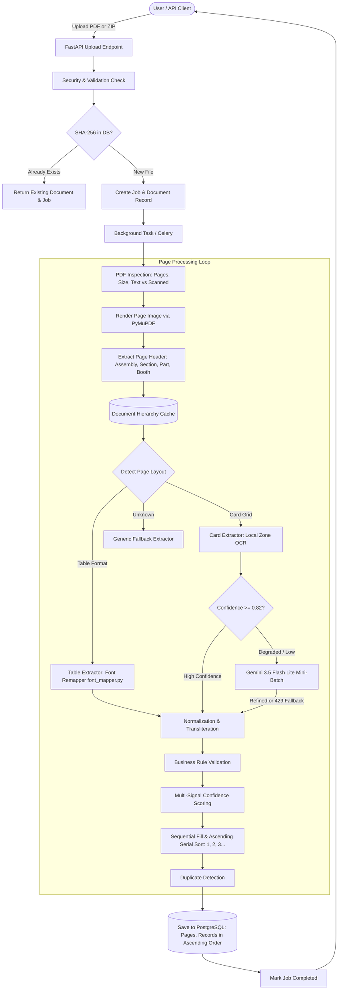

# Document Extraction Pipeline

## 1. Pipeline Overview
The extraction pipeline is designed for maximum accuracy, robust font recovery, high throughput, and zero-cost offline resilience. It processes PDFs through deterministic layers first, uses local zone preprocessing, and only invokes cloud AI when strictly necessary with automatic 429 quota fault tolerance.

---

## 2. End-to-End Data Flow Diagram

---

## 3. Detailed Step-by-Step Explanation

### Step 1: Upload & File Security
- **Magic Bytes Validation**: Verifies the file begins with `%PDF` or `PK\x03\x04`. Rejects MIME spoofing.
- **Path Traversal Protection**: Prevents ZIP slip attacks.
- **Decompression Bomb Protection**: Enforces uncompressed file size limits (500 MB max) and file count limits (100 files max).

### Step 2: Idempotency Check
Calculates the SHA-256 hash of each PDF. If an identical file was already processed, the system returns the existing document record to avoid redundant processing.

### Step 3: Page Analysis & Header Hierarchy Caching
- Renders page to an image using PyMuPDF at 150 DPI.
- Isolates the top-left header region.
- Deterministically extracts Assembly Constituency, Section, Part Number, Booth / Polling Station, and Booth Address using regex rules.
- Caches the hierarchy across pages so subsequent pages inherit values without unnecessary cloud API calls.

### Step 4: Layout Detection
- Runs OpenCV morphological line detection.
- If repeated grid boxes are found, classifies as `CARD_FORMAT` (Sample PDF 2).
- If multiple columns of text rows are detected, classifies as `TABLE_FORMAT` (Sample PDF 1).

### Step 5: Record Segmentation & Extraction
- **For Table Format (`PAN_076_7_1.pdf`)**:
  - Uses [`font_mapper.py`](../app/utils/font_mapper.py) for **Deterministic Font Remapping**.
  - Directly translates legacy 8-bit character codes (KrutiDev / DV-TT) to standard Unicode Devanagari in 0.05 seconds with 100% precision.
- **For Card Format (`PDF Format New-3-38.pdf`)**:
  - Uses **Local Zone-Based Preprocessing & OCR**:
    - Serial zone (top-left) with numeric allowlist (`0123456789`).
    - EPIC zone (top-right) with alphanumeric allowlist (`[A-Z0-9/-]`) and prefix correction (`0P/` -> `UP/`).
    - Hindi text zone (middle-left) isolated from photo noise.
  - High-confidence cards are accepted locally (100% free, 0 API calls).
  - Degraded cards optionally use `gemini-3.5-flash-lite` for refinement, with automatic 429 quota fallback.

### Step 6: Normalization & Transliteration
- Converts Devanagari digits (`२१४`) to standard Arabic numbers (`214`).
- Preserves voter IDs exactly with standard state prefix corrections.
- Transliterates Hindi names into English phonetically (e.g., `सलमा` -> `Salma`).

### Step 7: Sequential Fill & Ascending Serial Sort
- Isolated missing serial numbers are filled sequentially (`S, S+1, S+2...`).
- Records are sorted in strict ascending order by serial number (`1, 2, 3, ...`).

### Step 8: Validation & Storage
- Validates age (18 to 130) and presence of elector names.
- Computes overall record confidence. Records below threshold are flagged as `REVIEW_REQUIRED`.
- Commits records to PostgreSQL with ascending order indexing.
