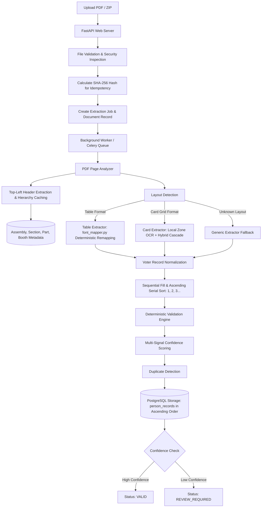

# High-Level Design (HLD)

## 1. Problem Statement
Electoral roll PDFs in India contain critical democratic voter information published in various formats. Some are text-based PDFs where legacy fonts corrupt the Hindi Unicode text layer. Others are scanned raster images with no text layer at all. Some use a multi-column table format (e.g., 100 records per page), while others use a grid of rectangular voter cards (e.g., 30 cards per page).

## 2. System Goal
The goal of this platform is to extract highly accurate, structured voter and electoral location data from Hindi and English electoral PDFs, validate the records deterministically, and store them in a properly normalized PostgreSQL database in ascending serial number order.

Accuracy is the highest priority:
1. NEVER hallucinate or invent data.
2. If data is unreadable, set it to `NULL` and flag `REVIEW_REQUIRED`.
3. Separate page-level electoral hierarchy (Assembly, Section, Part, Booth) from voter records.
4. Process clean records locally (100% free, offline, unlimited) and maintain 429 quota resilience if cloud AI is invoked.

---

## 3. High-Level Architecture Diagram

---

## 4. Key Components

### 4.1 FastAPI Application
Receives document uploads, performs fast security checks, provides asynchronous job status tracking, and serves REST API queries for voter records with ascending serial number ordering by default.

### 4.2 Redis & Background Workers
Ensures large PDFs are processed asynchronously in the background. HTTP upload requests return immediately with a `job_id`.

### 4.3 PDF Analyzer & Image Renderer
Uses PyMuPDF to analyze page dimensions, detect whether pages have an embedded text layer or are scanned raster images, and render pages to high-resolution images.

### 4.4 Header Extraction & Hierarchy Cache
Extracts the top-left page header (Assembly, Section, Part, Booth) and caches it across pages in a document, eliminating redundant cloud AI calls.

### 4.5 Deterministic Font Remapper (`font_mapper.py`)
Remaps legacy 8-bit non-Unicode fonts (KrutiDev / DV-TT Surekh) directly to Devanagari Unicode in 0.05 seconds with 100% precision, avoiding slow visual OCR.

### 4.6 Local Zone-Based OCR Engine
Isolates card regions (Serial number zone with numeric allowlist, EPIC zone with alphanumeric allowlist, and Hindi text zone) to extract clean voter details locally and offline.

### 4.7 Hybrid Confidence Cascade & Gemini 3.5 Flash Lite
Evaluates extracted cards: accepts clean records locally (100% free), and sends only degraded cards to `gemini-3.5-flash-lite` for refinement. Gracefully catches 429 rate limit errors to ensure processing never fails.

### 4.8 PostgreSQL & SQLAlchemy 2.x
Stores the normalized data across `documents`, `document_pages`, `person_records`, `extraction_field_results`, `extraction_jobs`, and `processing_errors`. All records are indexed and returned in ascending serial number order.
